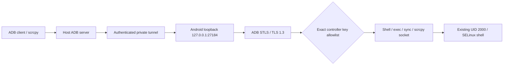

# private-adbd

**A loopback-only ADB endpoint for an existing Android shell session.**


private-adbd implements a small ADB service set without replacing the system `adbd`.
It runs with **UID 2000**, requires **SELinux Enforcing**, and binds only to **`127.0.0.1:27184`**.
An exact public-key allowlist controls access through ADB STLS and TLS 1.3.

> **Experimental, security-sensitive software.** This project has no independent security audit or broad device-compatibility certification.
> Authorized clients get Android shell access, not a read-only interface.
> Review the [security model](#security-model) before use.

## At a glance

- Explicit device identity with a required `--serial` argument.
- One or two Android ADB RSA public keys. No network enrollment or pairing service.
- TLS 1.3 only. Unknown keys and invalid policy files fail closed.
- Shell v1, raw shell v2, `exec:`, and basic ADB file sync.
- Forward connections to bounded `scrcpy_*` abstract sockets on Linux.
- Connection and stream limits, cancellation, and Linux process-group cleanup.
- Go standard library only. No APK, root helper, controller, or background installer.

## Architecture



The private tunnel is an external component. This repository does not configure peer identity, ACLs, forwarding, or VPN ownership.

A userspace Tailscale or Headscale-connected relay can forward private traffic to the loopback listener.
TailSocks does not need to own Android's VPN slot for that userspace forwarding pattern.
FlClash can remain the only Android VPN owner, subject to your relay configuration and device behavior.
These integrations are not bundled or certified here.

## Security model

| Boundary | Behavior |
| --- | --- |
| Process identity | Startup requires UID 2000 and an exact match with `ro.serialno`. |
| Android policy | Startup requires `u:r:shell:s0` and SELinux Enforcing. |
| Listener | IPv4 loopback only, fixed port `27184`. No public-bind flag. |
| Controller identity | TLS verifies private-key possession and matches the complete RSA public key against the allowlist. |
| Policy file | Empty, malformed, duplicate, oversized, or permissively accessible files fail startup. |
| Revocation | A one-second polling loop cancels sessions when policy bytes change or file validation fails. |
| Server identity | The daemon creates an ephemeral server certificate. Stock ADB does not pin it here. |
| Privileges | The daemon inherits shell privileges. It does not grant root or change SELinux policy. |

**The private tunnel must authenticate the device endpoint.** Client-key verification alone does not give stock ADB server-certificate pinning.
Do not expose this listener through an unauthenticated public TCP forward.

The service allowlist is not a command sandbox.
An authorized client can execute arbitrary shell commands and access files available to UID 2000.
File sync is not confined to the working directory.
Shared shell-UID processes can also threaten the daemon, its files, and its environment.

Read [docs/SECURITY.md](docs/SECURITY.md) for trust assumptions, key handling, and reporting guidance.

## Requirements

- Go **1.25.0 or later**, as declared in `go.mod`.
- An arm64 Android device that permits a standalone Linux Go binary under an existing shell session.
- An authorized bootstrap path that already gives UID 2000 in the `u:r:shell:s0` context.
- SELinux Enforcing and working Android `getprop` and `/system/bin/sh` commands.
- A host ADB client with STLS/TLS 1.3 support and an Android-format RSA-2048 key with exponent 65537.
- An authenticated private relay for remote use.
- Optional: scrcpy with forward-tunnel mode.

Device policy, Android releases, and client versions can change compatibility. Verify your own combination before relying on it.

## Build and test

From a POSIX shell:

```sh
go test ./...
go vet ./...
mkdir -p build
CGO_ENABLED=0 GOOS=linux GOARCH=arm64 \
  go build -trimpath -o build/private-adbd ./cmd/private-adbd
```

PowerShell cross-build:

```powershell
$env:CGO_ENABLED = '0'
$env:GOOS = 'linux'
$env:GOARCH = 'arm64'
go build -trimpath -o build/private-adbd ./cmd/private-adbd
Remove-Item Env:GOOS, Env:GOARCH, Env:CGO_ENABLED
```

Run the full tests on Linux as well as your development host.
Windows tests do not exercise Linux abstract sockets, process groups, signals, or Unix permission checks.
Shell tests require a real `bash` or `sh`. They skip when neither exists.
A cross-build verifies compilation, not Android execution or scrcpy compatibility.

## Setup

### 1. Prepare a dedicated controller key

Keep private keys **outside this repository**.
The example uses a separate host key directory:

```sh
mkdir -p "$HOME/.private-adbd"
chmod 700 "$HOME/.private-adbd"
adb keygen "$HOME/.private-adbd/adbkey"
chmod 600 "$HOME/.private-adbd/adbkey"
```

Only `adbkey.pub` belongs on the device.
The allowlist accepts Android `adbkey.pub` lines, not SSH public keys or PEM certificates.
It permits at most two distinct keys. A comment does not grant access.

Load the dedicated key before you start the foreground daemon example.
Restarting the host ADB server disconnects its other ADB sessions.
Authorize this restart in your environment first.

```sh
export ADB_VENDOR_KEYS="$HOME/.private-adbd/adbkey"
adb kill-server
adb start-server
```

### 2. Install through an existing authorized ADB connection

Replace the bootstrap transport value before use.
It identifies the existing ADB connection, not the new daemon endpoint.

```sh
BOOTSTRAP_SERIAL='replace-with-existing-adb-transport'
EXPECTED_SERIAL=$(adb -s "$BOOTSTRAP_SERIAL" shell getprop ro.serialno | tr -d '\r\n')
test -n "$EXPECTED_SERIAL"
adb -s "$BOOTSTRAP_SERIAL" shell id
adb -s "$BOOTSTRAP_SERIAL" shell getenforce
adb -s "$BOOTSTRAP_SERIAL" shell 'umask 077; mkdir -p /data/local/tmp/private-adbd; chmod 700 /data/local/tmp/private-adbd'
adb -s "$BOOTSTRAP_SERIAL" push build/private-adbd /data/local/tmp/private-adbd/private-adbd
adb -s "$BOOTSTRAP_SERIAL" push "$HOME/.private-adbd/adbkey.pub" /data/local/tmp/private-adbd/authorized_keys
adb -s "$BOOTSTRAP_SERIAL" shell 'chmod 700 /data/local/tmp/private-adbd/private-adbd; chmod 600 /data/local/tmp/private-adbd/authorized_keys'
adb -s "$BOOTSTRAP_SERIAL" shell 'ls -ldn /data/local/tmp/private-adbd; ls -ln /data/local/tmp/private-adbd/authorized_keys'
```

Stop if `id` does not show UID 2000 or `getenforce` does not show `Enforcing`.
Verify directory and key-file ownership as UID 2000.
The directory must have mode `0700`. The allowlist must have mode `0600`.
The daemon checks file modes, type, size, and immediate parent safety. It does **not** verify the key-file owner's UID itself.
Keep all path ancestors trusted. Do not use symlinks.

### 3. Start in the foreground

Use the actual `ro.serialno` value, not a guessed ADB transport name.
No serial default exists.

```sh
adb -s "$BOOTSTRAP_SERIAL" shell -T \
  /data/local/tmp/private-adbd/private-adbd \
  --serial "$EXPECTED_SERIAL" \
  --keys /data/local/tmp/private-adbd/authorized_keys
```

Keep this session open for the foreground example.
Startup rejects the wrong UID, serial, SELinux context, or allowlist before it opens a listener.
Startup logs include the device serial. Redact logs before sharing them.

This source release contains no supervisor or `service.sh`.
This repository does not promise detached survival, automatic restart, or boot startup.

### 4. Configure your private relay

Forward an authenticated private endpoint to Android `127.0.0.1:27184`.
Allow only your controller peers through the relay's ACLs.
Verify the relay's device identity independently.

The following examples use the fictional name `device.example.invalid`.
Replace it with your authenticated relay endpoint.
Do not change the daemon to bind a LAN or public address.

## ADB and scrcpy

The host ADB server must already have the matching controller private key, as configured in setup step 1.
Do not restart that server while it carries the foreground daemon's bootstrap session.

```sh
adb connect device.example.invalid:27184
adb -s device.example.invalid:27184 shell -T 'id'
adb -s device.example.invalid:27184 push -Z ./example.txt /data/local/tmp/example.txt
adb -s device.example.invalid:27184 pull -Z /data/local/tmp/example.txt ./example-copy.txt
scrcpy --serial=device.example.invalid:27184 --force-adb-forward
```

`-Z` disables file-transfer compression, which this basic sync implementation does not advertise.
The examples require your own relay, enrolled key, device, and local `example.txt`.
They are usage instructions, not a tested compatibility matrix.

Use `adb shell -T` for raw shell input. The daemon does not implement PTY allocation or terminal resizing.
Use scrcpy's forward mode because the daemon does not implement reverse forwarding.
Only abstract socket names with the `scrcpy_` prefix and a bounded safe character set can connect.

## Key management

- Keep controller private keys on trusted hosts. Do not send them to the device.
- Verify each public key through a trusted channel before installation.
- Preserve owner-only permissions when you replace the allowlist.
- Replace the whole file atomically from a trusted shell context when possible.
- Any byte change, read failure, or invalid file state cancels current sessions on the next polling check.
- Restart the daemon after a policy change. There is no live enrollment or key reload.
- A two-key overlap can support rotation. Remove the old key and restart again after the new key works.

Revocation uses polling. It is not instantaneous.
It does not undo completed commands or remove files that an authorized client created.
It cannot contain commands that deliberately escape the managed process group.

## Lifecycle limits and unsupported features

- No root, `su`, privilege escalation, SELinux changes, or system `adbd` replacement.
- No PTY, daemon-side reverse forwarding, arbitrary TCP services, or pairing discovery.
- No full stock-ADB feature parity, compressed sync, or guaranteed install/reboot workflows.
- No included APK, controller app, relay, deployment automation, or boot service.
- Linux cleanup manages the shell process group. Descendants can escape through `setsid` or `setpgid`.
- Android can terminate shell processes. OEM power management and reboot remove any persistence assumption.
- A foreground launch does not establish a supervised service. Validate lifecycle behavior on your own device.

## Repository layout

```text
cmd/private-adbd/      Startup gates and loopback listener
internal/runtimecfg/  Device identity and key-file checks
internal/security/    Android key parsing and TLS policy
internal/transport/   ADB packets, TLS upgrade, and stream multiplexer
internal/services/    Shell, basic sync, and scrcpy abstract sockets
docs/SECURITY.md      Threat model and reporting guidance
```

Tests create disposable keys and fictional identities.
This source release excludes operational data, real allowlists, private keys, APKs, compiled binaries, and device integration tests.

## Maintenance and contributions

This is a focused daemon core, not a general remote-device management product.
Maintainer work centers on the explicit security boundaries and the supported service subset.
There is no support SLA or promise to support every Android, ADB, scrcpy, or relay version.

See [CONTRIBUTING.md](CONTRIBUTING.md) before proposing a change.
Do not include device identifiers, endpoint addresses, keys, or unredacted operational logs in issues or patches.

## License

[MIT](LICENSE). Copyright (c) 2026 EiraWalker.
